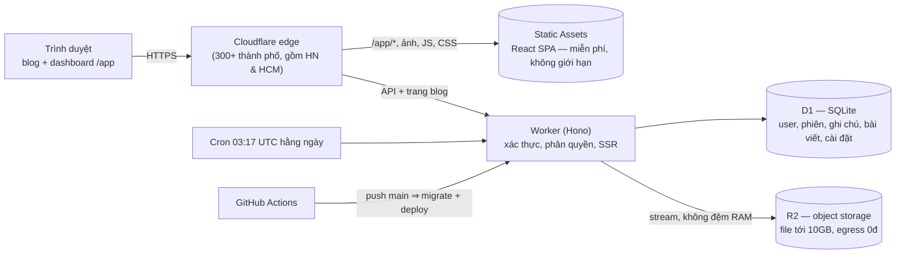

# WebBlogger

Blog cá nhân + ghi chú + kho lưu trữ file (Word, Excel, video… tới **10 GB/file**), có phân quyền **admin / user**, chạy **miễn phí** trên Cloudflare (Workers + D1 + R2).

- **Blog công khai**: render HTML sẵn ở edge (nhanh, chuẩn SEO), RSS, sitemap, thẻ, tìm kiếm, trang tĩnh (Giới thiệu, Liên hệ…), hẹn giờ đăng, giao diện sáng/tối.
- **Tùy biến không cần code**: tên blog, màu chủ đạo, phông chữ, bố cục danh sách/thẻ, menu, mạng xã hội, chân trang, CSS và HTML `<head>` riêng (Google Analytics…).
- **Ghi chú Markdown**: tự lưu, ghim, thẻ, tìm kiếm, dán/kéo-thả ảnh, chống ghi đè khi admin và chủ ghi chú cùng sửa.
- **Kho file**: thư mục, upload chia phần chạy song song (tự thử lại, tạm dừng/tiếp tục, tải tiếp sau khi tải lại trang), xem trước Word/Excel/PDF/ảnh/video/văn bản ngay trên trình duyệt, chia sẻ link công khai, tải xuống hỗ trợ resume.
- **Phân quyền**: admin quản lý người dùng, xem/sửa/xóa mọi ghi chú và file; user chỉ thấy dữ liệu của mình.
- **Đăng lên mạng xã hội**: đăng tự động lên Facebook Fanpage, Zalo OA, TikTok (bài ảnh) ngay từ trình soạn bài; trang bài viết có nút chia sẻ thủ công cho tài khoản cá nhân.

---

## Kiến trúc



| Thành phần | Công nghệ | Hạn mức miễn phí |
| --- | --- | --- |
| API + blog SSR | Cloudflare Workers, Hono | 100.000 request/ngày, 10 ms CPU/request |
| Dashboard | React 19, Vite, Tailwind CSS 4 (Static Assets) | không giới hạn |
| Cơ sở dữ liệu | D1 (SQLite) | 5 GB, 500 MB/database, 5 triệu lượt đọc + 100k lượt ghi/ngày, Time Travel 7 ngày |
| Lưu trữ file | R2 | 10 GB, 1 triệu lệnh ghi + 10 triệu lệnh đọc/tháng, **băng thông tải xuống 0đ** |
| CI/CD | GitHub Actions | miễn phí |

### Vì sao "mạnh và tối ưu"

- **Không máy chủ, không cold start**: code chạy ở edge gần người đọc; không phải vá OS, không lo sập server.
- **Blog gần như 0 CPU**: Markdown được chuyển thành HTML ngay trên trình duyệt của admin lúc lưu bài; trang công khai chỉ đọc HTML có sẵn từ D1 (truy vấn gộp 1 lượt).
- **File lớn**: trình duyệt cắt file thành phần 50 MB (vừa giới hạn 100 MB/request của gói Free), gửi 3 phần song song, lỗi mạng tự thử lại với backoff. Worker chuyển dữ liệu thẳng vào R2 multipart (`FixedLengthStream`), không giữ trong RAM. Tải xuống hỗ trợ `Range` (tải tiếp, tua video) và `ETag` (304).
- **Không bao giờ vượt 10 GB miễn phí ngoài ý muốn**: quota từng user + giới hạn toàn hệ thống (mặc định 9,5 GB) được kiểm tra và **giữ chỗ trong cùng một câu SQL**, nên upload song song cũng không vượt.
- **Mật khẩu chuẩn OWASP mà vẫn vừa 10 ms CPU**: trình duyệt chạy PBKDF2-SHA256 600.000 vòng, server chỉ băm SHA-256 với salt ngẫu nhiên. Server không bao giờ thấy mật khẩu gốc; lộ DB vẫn phải trả đủ 600k vòng cho mỗi lần đoán.
- **Dashboard nhẹ**: tách code theo trang; thư viện nặng (Markdown, xem trước Word/Excel) chỉ tải khi dùng; asset có hash được cache 1 năm.

---

## Chạy trên máy (dev)

Yêu cầu: **Node.js ≥ 22.22** (đã kiểm thử với Node 24 trên Windows).

> **Windows PowerShell báo `npm.ps1 cannot be loaded because running scripts is disabled`?** Chạy lệnh sau một lần (chỉ áp dụng cho tài khoản của bạn, không cần quyền admin), rồi mở lại cửa sổ PowerShell:
>
> ```powershell
> Set-ExecutionPolicy -Scope CurrentUser -ExecutionPolicy RemoteSigned
> ```
>
> Không muốn đổi cài đặt thì gõ `npm.cmd` / `npx.cmd` thay cho `npm` / `npx`, hoặc dùng Command Prompt / Git Bash.

```powershell
cd C:\Projects\WebBlogger              # mọi lệnh npm đều chạy trong thư mục dự án
npm install
npm run db:migrate:local              # tạo database cục bộ (.wrangler/state)
npm run create-admin -- --local       # tạo tài khoản admin cho môi trường dev
npm run dev                           # chạy Worker (8787) + Vite (5173)
```

- Dashboard (tự reload khi sửa code): <http://localhost:5173/app/>
- Blog + API: <http://localhost:8787/>

Mở bằng `localhost`, không dùng IP LAN qua `http://` — trình duyệt chỉ cho dùng WebCrypto (băm mật khẩu khi đăng nhập) trên HTTPS hoặc localhost.

Xem bản giống production: `npm run preview` (build rồi phục vụ tất cả ở <http://localhost:8787/>). Xóa dữ liệu dev: xóa thư mục `.wrangler/state`.

**Kiểm thử end-to-end API** (60+ kiểm tra: phân quyền, CSRF, upload nhiều phần, Range, quota, blog…):

```powershell
npx wrangler dev --port 8787 --var UPLOAD_PART_SIZE_MB:5    # cửa sổ 1: phần nhỏ để test multipart nhanh
$env:ADMIN_EMAIL="email-admin-dev"; $env:ADMIN_PASSWORD="mat-khau-admin-dev"
npm run test:smoke                                           # cửa sổ 2
```

---

## Deploy miễn phí lên Cloudflare

1. **Tạo tài khoản** Cloudflare miễn phí: <https://dash.cloudflare.com/sign-up>.
2. **Kích hoạt R2** (một lần): trong dashboard mở mục **R2 Object Storage** và làm theo hướng dẫn kích hoạt gói miễn phí. Cloudflare yêu cầu gắn thẻ Visa/Mastercard hoặc PayPal để xác minh; **không bị trừ tiền** khi dùng trong hạn mức, và hệ thống mặc định chặn tổng dung lượng ở 9,5 GB.
3. **Đăng nhập** từ máy của bạn:
   ```powershell
   npx wrangler login
   ```
4. **Tạo D1 + R2** (đặt dữ liệu ở châu Á – Thái Bình Dương, gần Việt Nam) và tự ghi `database_id` vào `wrangler.jsonc`:
   ```powershell
   npm run cf:setup
   ```
5. **Deploy** (build dashboard → migrate D1 → deploy Worker). Lần đầu wrangler có thể hỏi đăng ký subdomain `*.workers.dev` miễn phí:
   ```powershell
   npm run deploy
   ```
6. **Tạo admin đầu tiên** trên database production (mật khẩu được hỏi và không hiện lên màn hình):
   ```powershell
   npm run create-admin -- --remote
   ```
7. Mở `https://webblogger.<subdomain>.workers.dev/app/`, đăng nhập, vào **Cài đặt blog** để tùy biến.

Muốn đổi địa chỉ? Sửa `"name"` trong `wrangler.jsonc` trước khi deploy (URL là `https://<name>.<subdomain>.workers.dev`).

> Không có trang "setup" công khai: admin đầu tiên chỉ được tạo bằng CLI có quyền vào tài khoản Cloudflare của bạn, nên không ai chiếm được hệ thống trong lúc bạn vừa deploy.

### Tự động deploy khi push code (CI/CD)

Workflow `.github/workflows/deploy.yml` chạy typecheck → build → migrate D1 → deploy mỗi lần push lên `main`.

1. Đưa code lên GitHub (repo private cũng được):
   ```powershell
   git init
   git add .
   git commit -m "WebBlogger"
   git branch -M main
   git remote add origin https://github.com/<ban>/webblogger.git
   git push -u origin main
   ```
2. Tạo API token tại <https://dash.cloudflare.com/profile/api-tokens>: dùng template **Edit Cloudflare Workers** rồi thêm quyền **D1 · Edit**.
3. Trong GitHub repo → **Settings → Secrets and variables → Actions**, thêm `CLOUDFLARE_API_TOKEN` và `CLOUDFLARE_ACCOUNT_ID`.

Nhớ commit `wrangler.jsonc` sau khi chạy `cf:setup` (chứa `database_id`, không phải thông tin bí mật).

### Tên miền riêng (tùy chọn)

Thêm domain vào Cloudflare (gói Free) rồi vào **Workers & Pages → webblogger → Settings → Domains & Routes → Add → Custom domain**. Trên tên miền riêng, file công khai (ảnh trong bài viết…) còn được cache tại edge qua Cache API.

---

## Đăng bài lên Facebook, Zalo, TikTok

Các nền tảng **không cho phép ứng dụng tự đăng lên trang cá nhân**, nên đăng tự động chỉ áp dụng cho:

| Nền tảng | Đăng lên | Hình thức | Yêu cầu |
| --- | --- | --- | --- |
| Facebook | Fanpage bạn quản lý | Bài viết + link (Facebook tự lấy ảnh, tiêu đề từ trang bài) | App trên developers.facebook.com (chế độ Development là đủ cho Fanpage của bạn) |
| Zalo | Zalo Official Account | "Bài viết" OA đầy đủ nội dung, ảnh | Có OA, app trên developers.zalo.me, xác thực tên miền |
| TikTok | Tài khoản TikTok | Bài ảnh (JPG/WEBP) + chú thích + link | App trên developers.tiktok.com, xác minh tên miền chứa ảnh. App chưa qua kiểm duyệt: bài được gửi vào hộp thư TikTok để bạn hoàn tất trong app |

Thiết lập (một lần, cần site đã deploy với HTTPS):

1. Mã hóa token trong database (khuyến nghị): `npx wrangler secret put TOKEN_SECRET` rồi nhập một chuỗi ngẫu nhiên ≥ 32 ký tự.
2. Dashboard → **Mạng xã hội**: mỗi nền tảng có hướng dẫn từng bước, ô **Redirect URI** để dán vào trang developer, ô nhập App ID / Secret → **Lưu** → **Kết nối**.
3. Zalo và TikTok yêu cầu đặt file xác minh ở gốc tên miền: thêm ở **Cài đặt blog → Nâng cao → File xác minh tên miền**.
4. Mở một bài **đã xuất bản** → khung **Đăng lên mạng xã hội** → chọn nền tảng → Đăng. Lịch sử và lỗi (nếu có) hiện ngay bên dưới; Zalo/TikTok xử lý bất đồng bộ nên trạng thái tự cập nhật.

Token Zalo (~25 giờ) và TikTok (24 giờ) được tự làm mới khi đăng; token Fanpage Facebook không hết hạn. Nếu bạn đổi mật khẩu Facebook hoặc thu hồi quyền, bấm **Kết nối lại**.

Với tài khoản **cá nhân**: trang bài viết công khai có nút chia sẻ Facebook, nút chia sẻ qua ứng dụng trên điện thoại (Zalo, TikTok, Messenger…) và sao chép link.

---

## Phân quyền

| Chức năng | User | Admin |
| --- | :---: | :---: |
| Ghi chú, thư mục, file của chính mình | ✅ | ✅ |
| Chia sẻ file công khai | ✅ | ✅ |
| Xem / sửa / xóa ghi chú và file của **mọi người** | — | ✅ |
| Duyệt kho file và upload vào kho của user khác | — | ✅ |
| Tạo / sửa / khóa / xóa user, đổi vai trò, đặt lại mật khẩu, đặt hạn mức | — | ✅ |
| Viết bài, xuất bản, trang tĩnh | — | ✅ |
| Cài đặt blog, giới hạn lưu trữ | — | ✅ |
| Nhật ký hệ thống | — | ✅ |

Phân quyền được kiểm tra ở **server** cho từng request. User thường không thể biết ghi chú hay file của người khác có tồn tại hay không (luôn trả 404). Hệ thống luôn giữ ít nhất một admin đang hoạt động; khóa user, đặt lại mật khẩu hoặc đổi vai trò sẽ đăng xuất người đó ngay lập tức.

## Bảo mật

- Phiên đăng nhập: cookie `__Host-` + `HttpOnly` + `Secure` + `SameSite=Lax`; DB chỉ lưu SHA-256 của token; hết hạn sau 30 ngày không dùng; xem và đăng xuất thiết bị khác trong **Hồ sơ**.
- Chống CSRF (kiểm tra `Origin`/`Sec-Fetch-Site`), chống dò mật khẩu (10 lần/email, 30 lần/IP mỗi 15 phút).
- Mọi input được kiểm tra bằng zod; SQL dùng tham số (prepared statements).
- Dashboard có CSP chặt (`script-src 'self'`); nội dung Markdown của người khác được lọc bằng DOMPurify.
- File do user tải lên được phục vụ với `nosniff` + CSP `sandbox`; SVG/HTML luôn bị ép tải xuống nên không chạy được script trên domain của bạn.
- HSTS, `X-Frame-Options`, `Referrer-Policy`, `Permissions-Policy`.
- Nhật ký ghi lại đăng nhập, thao tác quản trị và thao tác của admin trên dữ liệu người khác (lưu 180 ngày).

> Tùy chọn "CSS tùy chỉnh", "HTML chèn vào head" và nội dung bài viết chỉ admin sửa được và chạy nguyên văn trên blog công khai; đó là chủ ý để bạn nhúng analytics, widget, video.

---

## Tùy biến bằng code

| Muốn sửa | File |
| --- | --- |
| Giao diện blog công khai (HTML) | `src/worker/site/components.tsx`, `src/worker/site/routes.tsx` |
| CSS blog công khai | `src/worker/site/styles.ts` |
| Các trang dashboard | `src/client/pages/*.tsx`, component dùng chung ở `src/client/components/` |
| API | `src/worker/routes/*.ts` |
| Cài đặt mặc định | `src/shared/settings.ts` |
| Hằng số (kích thước phần, thời hạn phiên…) | `src/shared/constants.ts`, biến `UPLOAD_PART_SIZE_MB` trong `wrangler.jsonc` |
| Database | thêm file mới `migrations/0002_ten.sql` rồi `npm run db:migrate:local` / `db:migrate:remote` |

Sau khi sửa `wrangler.jsonc`, chạy `npm run cf-typegen` để cập nhật kiểu cho Worker. Kiểm tra kiểu toàn dự án: `npm run typecheck`.

## Giới hạn & chi phí

Chỉ **R2** có thể tính tiền khi vượt hạn mức; Workers và D1 gói Free chỉ trả lỗi chứ không trừ tiền. Hệ thống tự bảo vệ (dashboard → **Hạn mức & dọn dẹp**):

| Chỉ số | Hạn mức miễn phí | Có thể tính phí? |
| --- | --- | --- |
| Dung lượng R2 | 10 GB | Có |
| Thao tác ghi R2 (upload, ghép file, liệt kê) | 1 triệu / tháng | Có |
| Thao tác đọc R2 (xem, tải file, ảnh công khai) | 10 triệu / tháng | Có |
| Database D1 | 500 MB | Không (chỉ bị chặn) |
| Request Worker | 100.000 / ngày | Không (chỉ bị chặn) |

- **3 ngưỡng** (mặc định 80% / 90% / 98%): *cảnh báo* trên Tổng quan → *tự dọn dẹp* → *tạm dừng* thao tác có thể tính phí (upload/tải file) tới đầu tháng sau.
- **Dọn dẹp mỗi giờ** (cron), từ an toàn nhất: hủy upload bỏ dở → xóa tệp thùng rác quá hạn (mặc định 30 ngày) → khi chạm ngưỡng dọn dẹp thì xóa thùng rác cũ nhất trước → dọn object "mồ côi" trên R2 → thu gọn log khi D1 gần đầy.
- **Thùng rác**: xóa tệp là chuyển vào thùng rác, khôi phục được. Tệp đang dùng, ghi chú, bài viết **không bao giờ** bị tự xóa — trừ khi admin tự bật "Tự xóa tệp riêng tư cũ hơn N ngày" (tệp công khai không bao giờ bị xóa).
- **Chế độ miễn phí tuyệt đối** (bật mặc định): tổng dung lượng không vượt 98% của 10 GB dù admin đặt giới hạn cao hơn. Tắt chế độ này khi bạn chấp nhận trả phí (R2 ~0,015 USD/GB/tháng; 50 GB ≈ 0,6 USD/tháng; tải xuống vẫn miễn phí).
- Lượt thao tác R2 và request do hệ thống tự đếm (ước lượng, sai số nhỏ); số chính xác xem ở dashboard Cloudflare → R2 → Metrics.
- Muốn bỏ giới hạn theo ngày của Workers: gói Workers Paid 5 USD/tháng.

## Ngôn ngữ (Tiếng Việt / English)

- **Dashboard**: nút *Tiếng Việt / English* ở thanh bên trái và trang đăng nhập; mỗi người tự chọn (lưu trên trình duyệt). Thông báo lỗi từ server cũng theo ngôn ngữ đã chọn.
- **Blog công khai**: Cài đặt blog → Giao diện → *Ngôn ngữ của blog* (menu, ngày tháng, nút chia sẻ…). Nội dung bài viết giữ nguyên như bạn viết.
- Thêm/sửa bản dịch: câu tiếng Việt trong code chính là khóa, bản dịch nằm ở `src/shared/i18n-en.ts`. Chạy `npm run i18n:check` để liệt kê câu chưa dịch.

## Vận hành

- **Sao lưu D1**: Time Travel giữ lịch sử 7 ngày (miễn phí) — khôi phục bằng `npx wrangler d1 time-travel restore DB --timestamp=<thời điểm>`. Xuất file SQL: `npx wrangler d1 export DB --remote --output=backup.sql`.
- **Xem log realtime**: `npx wrangler tail` hoặc mục Observability trên dashboard.
- **Quên mật khẩu admin**: `npm run create-admin -- --remote --email=<email-admin>` (đặt lại mật khẩu, bật lại quyền admin).
- **Cron hằng ngày** hủy upload bỏ dở quá 24 giờ (trả lại quota), xóa phiên hết hạn, xóa nhật ký cũ hơn 180 ngày.

## Cấu trúc thư mục

```text
WebBlogger/
├─ wrangler.jsonc              # cấu hình Cloudflare: Worker, D1, R2, cron, static assets
├─ migrations/0001_init.sql    # schema D1
├─ static/                     # _headers (CSP, cache), favicon — chép vào dist/client khi build
├─ src/
│  ├─ shared/                  # code dùng chung: hằng số, kiểu, băm mật khẩu, MIME, settings
│  ├─ worker/                  # backend (Cloudflare Worker)
│  │  ├─ index.ts              # router, header bảo mật, xử lý lỗi, cron
│  │  ├─ middleware.ts         # CSRF, phiên, requireAuth/requireAdmin
│  │  ├─ routes/               # auth, users, notes, drive (thư mục/file), uploads, posts, admin, stats
│  │  ├─ site/                 # blog công khai render ở server (Hono JSX)
│  │  └─ lib/                  # session, settings, stream file R2, audit, validate…
│  └─ client/                  # dashboard React (/app)
│     ├─ pages/                # Tổng quan, Ghi chú, Tệp, Bài viết, Người dùng, Cài đặt, Hồ sơ, Nhật ký
│     ├─ components/           # UI, trình soạn Markdown, xem trước file, bảng upload
│     └─ lib/                  # API client, upload engine, auth, theme
├─ scripts/                    # cf:setup, create-admin, smoke-test, copy-static
└─ .github/workflows/deploy.yml
```
